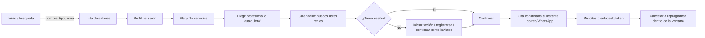
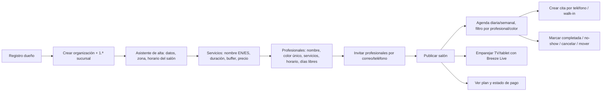
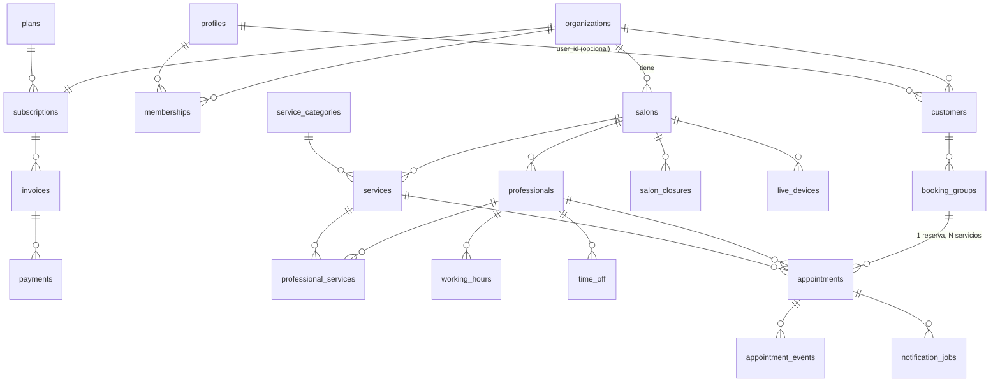

# Breeze — Plan de producto y arquitectura (Fase 2)

> Plataforma de reservas multi-salón para salones, spas, peluquerías y barberías en **Turks and Caicos**.
> Zona horaria `America/Grand_Turk` · Moneda USD · Inglés (por defecto) y español.
> Estado: **borrador para aprobación** — no hay código de producción todavía.

---

## 0. Decisiones confirmadas (Fase 1)

| Tema | Decisión |
|---|---|
| Cobro a salones | Suscripción por niveles según nº de profesionales, 14 días de prueba. **Facturación manual** (transferencia o efectivo). |
| Pagos del cliente | Sin pagos en línea en el MVP. El cliente paga en el salón (efectivo/transferencia). Esquema preparado para depósitos en el futuro. |
| Cancelación | Ventana configurable por salón (24 h por defecto). Ausencias (no-show) se registran; bloqueo opcional tras X ausencias (2 por defecto). |
| Organización | Un dueño puede tener **varias sucursales** (organización → salones). |
| Profesionales | Tienen **login propio** y ven solo su agenda. |
| Registro cliente | **Correo + teléfono** (ambos obligatorios en cuentas registradas). |
| Invitados | **Sí**, reserva sin cuenta (turistas): nombre + teléfono, correo opcional. |
| Confirmación | **Instantánea**: solo se ofrecen huecos libres reales. |
| Multi-servicio | Sí, varios servicios en una reserva, **en secuencia, nunca a la misma hora**. |
| Citas por teléfono / walk-in | Sí, el salón las crea desde el panel y bloquean el horario igual. |
| Tiempo entre citas | Sí, **buffer** (limpieza/preparación) configurable por servicio. |
| Idioma | Inglés por defecto; se adapta al idioma del teléfono/navegador; el usuario puede cambiarlo. |
| Notificaciones | WhatsApp primero, SMS de respaldo (integración preparada), correo siempre. Firmadas como **Breeze**. |
| Precios | $29 / $59 / $99 / +$39 por sucursal **aprobados como punto de partida**; se ajustarán más adelante (se guardan en tabla, no en el código). |
| Tipos de negocio | **Barbería**, **Salón** y **Estética / Spa**. Un negocio puede marcar varios. Cada tipo agrupa sus propias categorías de servicio (ver 6.2). |

---

## 1. Propuesta de valor

### 1.1 Problema local
- La mayoría de salones de TCI agenda por **WhatsApp, llamadas y libreta**. Resultado: doble reserva, huecos muertos y ausencias sin control.
- Las plataformas internacionales están pensadas para EE. UU./Europa: su gran baza (pagos integrados) **no funciona o funciona mal en TCI**, y cobran por funciones que aquí no se usan.
- Mucha mano de obra del sector es hispanohablante, mientras que los clientes (locales y turistas) suelen hablar inglés.
- Los turistas (estancias de 3–7 días) quieren reservar rápido, sin crear cuenta, desde el hotel o la villa.

### 1.2 Comparativa

> Los precios y la disponibilidad de los competidores cambian a menudo; las cifras son orientativas y **deben validarse** antes de usarlas en ventas.

| Criterio | Booksy | Fresha | Square Appointments | **Breeze** |
|---|---|---|---|---|
| Enfoque | Barberías/salones EE. UU. | Salones/spas global, marketplace | Comercios con Square POS | **Salones de TCI** |
| Modelo de precio | Suscripción + coste por profesional + comisión por clientes del marketplace | Planes por profesional + comisiones de pago/marketplace | Gratis 1 persona; planes por ubicación | **Tarifa plana por nivel, sin comisiones** |
| Pagos en TCI | Limitados / no soportados | Limitados / no soportados | Square **no opera en TCI** | **Diseñado para efectivo/transferencia** |
| Bilingüe EN/ES | Parcial | Sí (genérico) | Parcial | **Sí, también para el personal** |
| Pantalla en vivo para el salón | No | No | No | **Breeze Live** |
| Invitados (turistas) sin cuenta | Limitado | Sí | Sí | **Sí, con enlace para gestionar la cita** |
| Recordatorios por WhatsApp | No nativo | Limitado | No | **WhatsApp primero** |
| Búsqueda por zona de TCI | Genérica | Genérica | No hay marketplace | **Zonas locales (Grace Bay, Leeward, Downtown…)** |
| Soporte | Remoto, en inglés | Remoto | Remoto | **Local y en persona** |

### 1.3 Frase de valor
**Para salones de Turks and Caicos:** "Llena tu agenda sin doble reserva, con recordatorios por WhatsApp y una pantalla en vivo que motiva al equipo. Precio plano, sin comisiones, pagas como ya pagas todo: transferencia o efectivo."

**Para clientes y turistas:** "Reserva en 30 segundos con el profesional que quieres, en inglés o español, sin crear cuenta si estás de paso."

### 1.4 Diferenciadores defendibles
1. **Breeze Live**: elemento visible en el local (efecto vitrina y motivación del equipo). Ningún competidor lo tiene.
2. **Cero comisiones** y facturación adaptada a la realidad local.
3. **Garantía técnica de no doble reserva** (restricción en base de datos, no solo validación en la interfaz).
4. **Bilingüe real** para personal y clientes.
5. **Alianzas con hoteles/villas** (enlaces de concierge) — fase posterior.

---

## 2. Modelo de ingresos

### 2.1 Planes (aprobados como punto de partida; se actualizarán)

> Los precios y límites viven en la tabla `plans` (no en el código), para poder cambiarlos sin desplegar.

| Plan | Profesionales | Precio/mes | Incluye |
|---|---|---|---|
| **Solo** | 1–2 | $29 | Reservas, agenda, recordatorios por correo, invitados |
| **Studio** | 3–6 | $59 | + Breeze Live, recordatorios por WhatsApp/SMS (cupo mensual) |
| **Salon** | 7+ | $99 | + cupo mayor de mensajes, informes, soporte prioritario |
| Sucursal extra | — | +$39 por sucursal | Cada sucursal tiene su propio plan de profesionales |

- **Prueba gratis**: 14 días con todo incluido (plan Studio).
- **Pago anual**: 2 meses gratis (10 × mensual), muy útil con facturación manual: menos cobros.
- **Mensajes**: WhatsApp/SMS tienen coste real por mensaje (Twilio/Meta). Cada plan incluye un cupo; los paquetes extra se venden aparte (ej. 500 mensajes por $15).

### 2.2 Facturación manual (MVP)
1. El panel de **administración de plataforma** (rol `platform_admin`) genera la factura del periodo.
2. El dueño ve en su panel: plan, importe, fecha de vencimiento y datos para transferencia.
3. Al recibir el pago (transferencia o efectivo), el admin lo **registra** (método, referencia, fecha) y la suscripción pasa a `active`.
4. **Gracia de 7 días** tras el vencimiento → `past_due` (aviso en el panel). Tras 14 días → `suspended`: se desactiva la reserva en línea y Breeze Live, pero **nunca se borran datos** y la agenda sigue visible.
5. Más adelante: pasarela en línea (Stripe vía entidad en EE. UU., PayPal o banco local) sin cambiar el esquema.

### 2.3 Fuentes de ingreso futuras
- Paquetes de mensajes WhatsApp/SMS.
- Listado destacado en la búsqueda (sin comisión por reserva).
- Programa de concierge con hoteles y villas (enlace de reserva con marca del hotel).
- Depósitos en línea cuando haya pasarela (comisión fija pequeña).

### 2.4 Orden de magnitud
Mercado estimado (a validar): 150–300 negocios de belleza en TCI, concentrados en Providenciales.
Objetivo del año 1: **40 salones × $55 de media ≈ $2.200 MRR (~$26.000/año)**. Es un mercado pequeño: la clave es **retención altísima** y bajo coste de adquisición (venta directa, en persona).

---

## 3. Métricas clave

| Tipo | Métrica | Objetivo inicial |
|---|---|---|
| **North Star** | Citas completadas reservadas por Breeze al mes | Crecer mes a mes |
| Activación salón | % de salones que en 7 días tienen ≥1 profesional, ≥3 servicios, horario y su 1.ª reserva en línea | > 70 % |
| Tiempo de alta | Minutos desde el registro hasta el salón publicado | < 20 min |
| Conversión cliente | Vista de salón → reserva confirmada | > 15 % |
| Mezcla de canal | % de citas en línea vs. por teléfono | Subir con el tiempo |
| Ausencias | Tasa de no-show antes/después de los recordatorios | Bajar ≥ 30 % |
| Recordatorios | % entregados (WhatsApp/SMS/correo) | > 95 % |
| Breeze Live | Salones con pantalla activa la última semana | > 50 % de Studio/Salon |
| Negocio | MRR, churn mensual de salones, **tasa de cobro a tiempo** (clave con facturación manual) | Churn < 3 %, cobro > 90 % |
| Calidad | Intentos de doble reserva bloqueados por la BD (debe ser > 0 si hay concurrencia, y 0 dobles reales) | 0 dobles reservas |

Instrumentación: tabla `appointment_events` (historial de cada cita) más eventos de producto (PostHog o similar, **a decidir**; sin datos personales en los eventos).

---

## 4. Roles y flujos

### 4.1 Roles

| Rol | Alcance | Cómo entra |
|---|---|---|
| `customer` | Sus propias citas en cualquier salón | Registro con correo + teléfono |
| `guest` | Una reserva concreta | Sin cuenta; enlace firmado `/b/[token]` |
| `owner` | Toda su organización (todas las sucursales) | Registro de salón |
| `admin` | Una o varias sucursales | Invitación del owner |
| `professional` | Solo su propia agenda | Invitación del owner/admin |
| `display` | Breeze Live de una sucursal (solo lectura, datos públicos) | Emparejamiento con código |
| `platform_admin` | Facturación y soporte de Breeze | Interno |

### 4.2 Cliente (registrado o invitado)



- **Multi-servicio**: los servicios se encadenan uno tras otro (corte 10:00–10:30 + buffer → barba 10:40–11:00). Pueden ser con el mismo profesional o con distintos.
- **Invitado**: nombre + teléfono (+ correo opcional). Recibe un enlace único para gestionar su cita. Protección antiabuso: captcha (Cloudflare Turnstile), límite por IP/teléfono y máximo 2 citas futuras por teléfono no verificado.
- **Fuera de la ventana de cancelación**: el botón se desactiva y se muestra "llama al salón".
- **Bloqueado por ausencias** (si el salón lo activó): no puede reservar en línea en ese salón; se le indica que llame.

### 4.3 Dueño / admin del salón



### 4.4 Profesional
Iniciar sesión → **Mi agenda** (día/semana) → ver detalle de cita (nombre del cliente, servicios, notas) → marcar completada o no-show (si el salón lo permite) → solicitar un día libre (lo aprueba el admin; fase posterior: en el MVP lo carga el admin).

### 4.5 Breeze Live (`/live/[salonId]`)
1. La TV abre `/live/[salonId]` y muestra un **código de emparejamiento de 6 dígitos**.
2. El dueño/admin introduce el código en el panel → la TV queda autenticada con rol `display` solo para esa sucursal (sesión anónima de Supabase vinculada al salón; revocable desde el panel).
3. La pantalla carga la agenda del día (columnas por profesional, cabecera con **color + nombre + iniciales**).
4. Se suscribe a un **canal privado de Realtime** `live:{salonId}`. Cada cita nueva → alerta con el color del profesional:
   *"Juan P. just booked with Carlos for Tue, Nov 10 at 3:00 PM"* / *"Juan P. acaba de agendar con Carlos para el martes 10 de nov. a las 3:00 PM"* (idioma configurable por pantalla).
5. Sonido opcional (requiere un toque inicial en pantalla por la política de autoplay de los navegadores).
6. Reconexión automática y resincronización cada X minutos por si se cae la conexión; cambio de día automático a medianoche (hora de TCI).

**Privacidad**: el canal y la carga inicial solo contienen `nombre + inicial del apellido`, servicio, profesional, hora y estado. **Nunca** teléfono ni correo (los datos se generan ya recortados en la base de datos; la pantalla nunca recibe el dato completo).

### 4.6 Administrador de plataforma
Lista de organizaciones → plan, estado, vencimientos → registrar pago manual → suspender/reactivar → soporte (ver configuración, nunca editar citas sin dejar rastro en la auditoría).

---

## 5. Arquitectura

### 5.1 Stack (sin cambios respecto a lo pedido)
- **Next.js (App Router) + TypeScript + Tailwind CSS**.
- **Supabase**: Auth (correo + teléfono, sesiones anónimas para Live), Postgres, Realtime, Edge Functions, `pg_cron`.
- **i18n**: `next-intl` sin prefijo de idioma en la URL; idioma tomado de cookie → `Accept-Language` → inglés.
- **Fechas**: `@date-fns/tz` + `date-fns`. Todo se guarda en UTC (`timestamptz`) y se muestra en `America/Grand_Turk`.
- **Validación**: `zod` (compartido entre formularios y servidor).
- **Tests**: Vitest (lógica pura), pgTAP / tests SQL contra Supabase local (restricciones y RLS), Playwright (flujos principales).
- **Mensajería**: interfaz `NotificationProvider` con implementaciones `console` (desarrollo), `resend` (correo), `twilio-sms` y `twilio-whatsapp` (preparadas).
- **Hosting sugerido**: Vercel (web) + Supabase Cloud (región `us-east-1`, la más cercana a TCI).

> Todas las dependencias se listan aquí, pero **no se instalarán sin tu aviso previo** (regla de trabajo).

### 5.2 Decisiones técnicas clave

1. **No doble reserva = restricción en Postgres**
   ```sql
   create extension if not exists btree_gist;

   -- Rango ocupado por la cita = inicio .. fin + buffer
   occupied tstzrange generated always as (tstzrange(starts_at, blocked_until, '[)')) stored,

   constraint no_double_booking exclude using gist (
     professional_id with =,
     occupied        with &&
   ) where (status <> 'cancelled');

   -- El mismo cliente no puede tener dos servicios a la vez (multi-servicio en secuencia)
   constraint no_customer_overlap exclude using gist (
     customer_id with =,
     tstzrange(starts_at, ends_at, '[)') with &&
   ) where (status <> 'cancelled');
   ```
   - Rango semiabierto `[)`: una cita que termina a las 10:30 y otra que empieza a las 10:30 **no** chocan.
   - Si dos personas reservan el mismo hueco en el mismo milisegundo, Postgres acepta una y rechaza la otra (`23P01 exclusion_violation`) → la interfaz muestra "ese horario acaba de ocuparse" y recarga los huecos.

2. **Las reservas solo entran por funciones RPC** (`book_appointment`, `reschedule_appointment`, `cancel_appointment`, `staff_create_appointment`). Nadie hace `INSERT` directo en `appointments`. La función valida en una transacción: servicio activo, profesional que lo ofrece, dentro del horario laboral, fuera de días libres/cierres, ventana mínima de antelación, cliente no bloqueado, suscripción del salón activa. La exclusión de la BD es la última línea de defensa ante condiciones de carrera.

3. **Cálculo de disponibilidad**
   - Función **pura en TypeScript** (`src/lib/availability`) totalmente testeada:
     `slots = horario laboral (hora local → UTC por día) − días libres − cierres del salón − rangos ocupados (cita + buffer)`, cortado en pasos de 15 min (configurable), donde cabe `duración total + buffers`.
   - Entrada de datos vía RPC `get_busy_ranges(professional_ids, from, to)` (security definer) que devuelve **solo rangos de tiempo**, nunca datos de clientes.
   - Casos de test obligatorios: cambio de horario de verano en TCI (2.º domingo de marzo y 1.er domingo de noviembre), citas que tocan el borde, buffer, horario partido (descanso para comer), día libre parcial, multi-servicio, "cualquier profesional", hora mínima de antelación, reservas ya pasadas del día de hoy.

4. **Realtime para Live con Broadcast privado** (no `postgres_changes` sobre la tabla de citas): un trigger `after insert/update` en `appointments` llama a `realtime.send()` con un payload ya **saneado** al tema `live:{salon_id}`. La política RLS de `realtime.messages` solo deja leer ese tema a miembros `owner/admin/display` de esa sucursal.

5. **Recordatorios**: al crear/mover una cita se insertan filas en `notification_jobs` (24 h y 2 h antes, según la configuración del salón). `pg_cron` llama cada 5 min a la Edge Function `send-reminders`, que toma los trabajos vencidos con `FOR UPDATE SKIP LOCKED`, envía por el canal preferido (WhatsApp → SMS → correo) y guarda el resultado. Las plantillas son bilingües y firmadas como **"— Breeze"**. Cancelar o mover una cita anula o recalcula sus trabajos.

6. **Multi-tenant + RLS**: todas las tablas de negocio llevan `salon_id` u `organization_id`. Las funciones auxiliares `security definer`, `stable`, con `search_path` fijado, evitan recursión en las políticas.

---

## 6. Esquema de base de datos

### 6.1 Diagrama entidad-relación



### 6.2 Tablas

Convenciones: `id uuid default gen_random_uuid()`, `created_at/updated_at timestamptz`, fechas en UTC, dinero en **centavos** (`integer`), textos visibles bilingües con columnas `_en` / `_es`.

**Identidad y tenencia**

| Tabla | Columnas principales | Notas |
|---|---|---|
| `profiles` | `id` (= `auth.users.id`), `full_name`, `email citext`, `phone` (E.164), `locale` (`en`/`es`), `is_platform_admin bool` | Se crea por trigger al registrarse. |
| `organizations` | `name`, `slug unique`, `owner_id → profiles` | El "negocio" del dueño. |
| `salons` (sucursales) | `organization_id`, `name`, `slug unique`, `business_types business_type[]` (enum: `barbershop`, `salon`, `spa`; al menos uno — un negocio puede ser barbería y salón a la vez), `zone` (enum: `grace_bay`, `downtown_provo`, `leeward`, `long_bay`, `turtle_cove`, `the_bight`, `chalk_sound`, `five_cays`, `blue_hills`, `kew_town`, `grand_turk`, `north_caicos`, `middle_caicos`, `south_caicos`, `salt_cay`, …), `address`, `phone`, `timezone default 'America/Grand_Turk'`, `currency default 'USD'`, `slot_step_min default 15`, `min_lead_time_min default 60`, `max_advance_days default 60`, `cancellation_window_hours default 24`, `no_show_block_enabled default false`, `no_show_threshold default 2`, `reminder_offsets_min int[] default {1440,120}`, `is_published` | Columna `search tsvector` para buscar por nombre. |
| `memberships` | `user_id`, `organization_id`, `salon_id` (nulo = todas las sucursales), `role` (`owner`, `admin`, `professional`, `display`) | Fuente única de permisos. `unique(user_id, organization_id, salon_id, role)`. |
| `invitations` | `organization_id`, `salon_id`, `role`, `email`/`phone`, `token_hash`, `expires_at`, `professional_id` | Alta de admins y profesionales. |

**Catálogo y horarios**

| Tabla | Columnas principales | Notas |
|---|---|---|
| `professionals` | `salon_id`, `user_id` (nulo hasta aceptar la invitación), `first_name`, `last_name`, `public_name` (generado: "Carlos M."), `initials` (generado), `color_hex`, `title` (`barber`, `stylist`, `salonist`, `therapist`…), `bio_en/es`, `avatar_url`, `accepts_online`, `is_active`, `sort_order` | `unique(salon_id, color_hex)` → **color único por sucursal**. Paleta curada de 12 colores con buen contraste. |
| `service_categories` | `code` (PK), `business_type`, `name_en`, `name_es`, `sort_order` | Catálogo fijo de Breeze (seed), ver tabla 6.2.1. Lectura pública. |
| `services` | `salon_id`, `category_code → service_categories`, `name_en`, `name_es`, `description_en/es`, `duration_min`, `buffer_min default 0`, `price_cents`, `is_active` | `check (duration_min between 5 and 480)`. La categoría debe pertenecer a uno de los `business_types` del salón (validado por trigger). |
| `professional_services` | `professional_id`, `service_id`, `duration_min_override`, `price_cents_override` | PK compuesta. Un profesional puede tardar distinto. |
| `working_hours` | `professional_id`, `weekday` (0–6), `start_time time`, `end_time time` | **Hora local** del salón; varias filas por día = horario partido. `check (end_time > start_time)`. |
| `time_off` | `professional_id`, `starts_at`, `ends_at`, `reason` | Días/horas libres (UTC). |
| `salon_closures` | `salon_id`, `starts_at`, `ends_at`, `reason_en/es` | Festivos, huracán, etc. |

**Clientes y citas**

| Tabla | Columnas principales | Notas |
|---|---|---|
| `customers` | `organization_id`, `user_id` (nulo = invitado), `first_name`, `last_name`, `phone`, `email`, `locale`, `notes` (internas), `no_show_count`, `is_blocked`, `marketing_opt_in`, `whatsapp_opt_in` | Ficha **por organización** (compartida entre sus sucursales, invisible para otras). `unique(organization_id, user_id)`, índice en `(organization_id, phone)`. |
| `booking_groups` | `salon_id`, `customer_id`, `source` (`online`, `phone`, `walk_in`), `guest_token_hash`, `created_by` | Agrupa los servicios de una misma reserva; el enlace del invitado apunta aquí. |
| `appointments` | `booking_group_id`, `salon_id`, `professional_id`, `customer_id`, `service_id`, `starts_at`, `ends_at`, `blocked_until` (= fin + buffer), `occupied` (generado), `status` (`booked`, `completed`, `cancelled`, `no_show`), `price_cents` y `service_name_en/es` (copia en el momento de reservar), `customer_display` (generado: "Juan P."), `cancelled_at`, `cancelled_by`, `cancel_reason` | Restricciones `no_double_booking` y `no_customer_overlap` (ver 5.2). `check (ends_at > starts_at and blocked_until >= ends_at)`. |
| `appointment_events` | `appointment_id`, `type` (`created`, `rescheduled`, `cancelled`, `completed`, `no_show`), `actor_id`, `payload jsonb`, `at` | Historial y auditoría, también base de las métricas. |

**Breeze Live, notificaciones, facturación**

| Tabla | Columnas principales | Notas |
|---|---|---|
| `live_devices` | `salon_id`, `user_id` (sesión anónima), `name`, `locale`, `sound_enabled`, `pairing_code_hash`, `pairing_expires_at`, `paired_at`, `revoked_at`, `last_seen_at` | Al emparejarse se crea `memberships(role='display')`. |
| `notification_jobs` | `appointment_id`, `kind` (`confirmation`, `reminder`, `cancellation`, `reschedule`), `channel` (`whatsapp`, `sms`, `email`), `scheduled_for`, `status` (`pending`, `sent`, `failed`, `skipped`), `attempts`, `provider`, `provider_message_id`, `error`, `locale` | Índice parcial `(scheduled_for) where status='pending'`. |
| `plans` | `code` (`solo`, `studio`, `salon`), `name`, `min_pros`, `max_pros`, `monthly_price_cents`, `annual_price_cents`, `extra_branch_price_cents`, `message_quota`, `features jsonb`, `is_active` | Precios editables por `platform_admin` sin tocar código. |
| `subscriptions` | `organization_id unique`, `plan_code → plans`, `extra_branches`, `status` (`trialing`, `active`, `past_due`, `suspended`, `cancelled`), `trial_ends_at`, `current_period_end`, `billing_cycle` (`monthly`, `annual`), `message_quota` | |
| `invoices` | `organization_id`, `number`, `period_start/end`, `amount_cents`, `status` (`open`, `paid`, `void`), `due_at` | |
| `payments` | `invoice_id`, `method` (`bank_transfer`, `cash`, `other`), `amount_cents`, `reference`, `received_at`, `recorded_by` | Registro manual por `platform_admin`. |
| `audit_log` | `actor_id`, `organization_id`, `action`, `entity`, `entity_id`, `diff jsonb`, `at` | Acciones sensibles (soporte, cambios de rol, pagos). |

#### 6.2.1 Tipos de negocio y categorías de servicio (seed inicial)

| Tipo (`business_type`) | EN / ES | Categorías (`service_categories`) | Ejemplos de servicios |
|---|---|---|---|
| `barbershop` | Barbershop / Barbería | Cortes · Barba y afeitado · Diseños y perfilado · Tratamientos capilares | Corte clásico, fade, corte + barba, afeitado con toalla caliente, perfilado de cejas, diseño |
| `salon` | Salon / Salón | Cabello (corte y peinado) · Color · Trenzas y extensiones · Uñas · Maquillaje · Cejas y pestañas | Corte y blower, tinte, mechas, trenzas, extensiones, manicura, pedicura, acrílicas, gel, maquillaje de evento, lifting de pestañas |
| `spa` | Spa & Esthetics / Estética y Spa | Masajes · Faciales · Depilación · Tratamientos corporales · Paquetes | Masaje relajante, descontracturante, piedras calientes, facial limpieza profunda, depilación con cera/láser, exfoliación corporal, paquete pareja |

- En la **búsqueda** el cliente filtra por estos 3 tipos (y opcionalmente por categoría: "uñas", "masajes"…).
- Al **crear un servicio**, el salón elige una categoría de sus tipos; el nombre es libre (EN/ES).
- Las categorías se pueden ampliar después con una migración, sin tocar la lógica.

### 6.3 Funciones RPC (Postgres)

| Función | Quién | Qué hace |
|---|---|---|
| `get_busy_ranges(professional_ids, from, to)` | público | Solo rangos ocupados (sin datos personales). |
| `book_appointment(salon_id, items[], customer_payload, guest?)` | cliente / invitado | Valida todo y crea `booking_group` + N `appointments` en una transacción. Devuelve el token del invitado (en claro, una sola vez). |
| `staff_create_appointment(...)` | owner/admin (y profesional para sí mismo si se permite) | Citas por teléfono / walk-in; puede crear un cliente rápido. |
| `reschedule_appointment(id, new_start)` | cliente (en ventana) / staff | Mueve la cita; la exclusión se vuelve a comprobar. |
| `cancel_appointment(id, reason)` / `cancel_by_guest_token(token, …)` | cliente / invitado / staff | Respeta la ventana de cancelación (el staff puede saltársela). |
| `mark_appointment(id, status)` | staff | `completed` / `no_show` (incrementa `no_show_count` y bloquea si toca). |
| `get_live_board(salon_id, day)` | display/owner/admin | Agenda del día ya saneada para la pantalla. |
| `pair_live_device(code)` | owner/admin | Empareja una TV. |

### 6.4 Políticas RLS (resumen)

Funciones auxiliares (`security definer`, `stable`, `search_path = ''`):
- `auth_org_roles(org_id) → text[]`
- `has_org_role(org_id, roles text[]) → bool`
- `has_salon_role(salon_id, roles text[]) → bool` — `true` si la membresía es de esa sucursal **o** de toda la organización (`salon_id is null`).
- `my_professional_ids() → uuid[]`

| Tabla | `anon` / público | Cliente autenticado | Profesional | Owner / admin | Display |
|---|---|---|---|---|---|
| `salons` | `SELECT` si `is_published` (vista `public_salons` con columnas públicas) | igual | `SELECT` su sucursal | CRUD en su organización | `SELECT` su sucursal |
| `professionals` | `SELECT` activos, **solo columnas públicas** (`public_name`, `initials`, `color_hex`, `title`, `avatar_url`) mediante permisos por columna o vista | igual | `SELECT` su sucursal, `UPDATE` su perfil | CRUD | columnas públicas |
| `services`, `professional_services` | `SELECT` activos de salones publicados | igual | `SELECT` | CRUD | `SELECT` |
| `service_categories`, `plans` | `SELECT` | `SELECT` | `SELECT` | `SELECT` | `SELECT` (escritura solo `platform_admin`) |
| `working_hours`, `time_off`, `salon_closures` | ✗ (se usa `get_busy_ranges`) | ✗ | `SELECT` los propios | CRUD | ✗ |
| `customers` | ✗ | `SELECT/UPDATE` sus propias filas (`user_id = auth.uid()`) | `SELECT` clientes con cita con él | CRUD en su organización | ✗ |
| `appointments` | ✗ | `SELECT` las suyas; escritura **solo vía RPC** | `SELECT` `professional_id = any(my_professional_ids())` | `SELECT` en su sucursal; escritura vía RPC | ✗ (usa `get_live_board` + Broadcast) |
| `booking_groups`, `appointment_events` | ✗ | `SELECT` los suyos | los suyos | su sucursal | ✗ |
| `memberships`, `invitations` | ✗ | `SELECT` las propias | `SELECT` las propias | CRUD en su organización (solo `owner` crea `admin`) | ✗ |
| `notification_jobs` | ✗ | ✗ | ✗ | `SELECT` su sucursal | ✗ |
| `subscriptions`, `invoices`, `payments` | ✗ | ✗ | ✗ | `SELECT` (solo owner) | ✗ |
| `live_devices` | ✗ | ✗ | ✗ | CRUD su sucursal | `SELECT` el propio |
| `audit_log` | ✗ | ✗ | ✗ | `SELECT` su organización | ✗ |
| `realtime.messages` | ✗ | ✗ | ✗ | `SELECT` tema `live:{salon}` | `SELECT` tema `live:{salon}` |

`platform_admin` accede mediante funciones de servidor específicas y auditadas (no con `service_role` desde el navegador). La clave `service_role` **solo** vive en Edge Functions y en el servidor (variables de entorno), nunca en el cliente.

**Tests de RLS obligatorios**: un usuario del salón A no ve **nada** del salón B (citas, clientes, profesionales privados, horarios); un profesional no ve las citas de otro; el rol `display` nunca obtiene teléfono ni correo; `anon` no puede insertar citas directamente.

---

## 7. Estructura de carpetas

```
breeze/
├── CLAUDE.md                     # reglas para el asistente
├── README.md
├── .env.example                  # plantilla de variables (sin secretos)
├── docs/
│   └── PLAN.md                   # este documento
├── supabase/
│   ├── config.toml
│   ├── migrations/               # SQL versionado (tablas, RLS, RPC, triggers, cron)
│   ├── seed.sql                  # datos de demo (salones ficticios de Provo)
│   ├── tests/                    # pgTAP: doble reserva, RLS, RPC
│   └── functions/
│       ├── send-reminders/       # Edge Function de recordatorios
│       └── _shared/notifications/# proveedores: console, resend, twilio-sms, twilio-whatsapp
├── src/
│   ├── app/
│   │   ├── (marketing)/          # landing de Breeze y alta de salones
│   │   ├── (client)/             # app del cliente (mobile-first)
│   │   │   ├── page.tsx          # búsqueda
│   │   │   ├── s/[salonSlug]/    # perfil del salón y flujo de reserva
│   │   │   ├── me/appointments/  # mis citas
│   │   │   └── b/[token]/        # gestión de cita de invitado
│   │   ├── (auth)/               # login, registro, recuperar contraseña
│   │   ├── dashboard/[orgSlug]/[salonSlug]/
│   │   │   ├── agenda/           # agenda con filtro por profesional/color
│   │   │   ├── professionals/
│   │   │   ├── services/
│   │   │   ├── hours/
│   │   │   ├── customers/
│   │   │   ├── live/             # emparejar pantallas
│   │   │   └── settings/         # políticas, recordatorios, plan
│   │   ├── pro/                  # agenda del profesional
│   │   ├── live/[salonId]/       # Breeze Live (kiosco)
│   │   ├── admin/                # plataforma: organizaciones, facturas, pagos
│   │   └── api/                  # route handlers puntuales (webhooks de Twilio, etc.)
│   ├── components/
│   │   ├── ui/                   # botones, inputs, modales (Tailwind)
│   │   ├── booking/              # selector de servicio, profesional, calendario de huecos
│   │   ├── agenda/               # vista por columnas/colores
│   │   └── live/                 # alertas, columnas, reloj
│   ├── lib/
│   │   ├── availability/         # cálculo de huecos (puro, con tests)
│   │   ├── time/                 # utilidades de zona horaria America/Grand_Turk
│   │   ├── booking/              # orquestación de RPC y manejo de 23P01
│   │   ├── supabase/             # clientes browser/server/middleware
│   │   ├── colors/               # paleta de profesionales + contraste
│   │   ├── privacy/              # formateo "Juan P." y saneado
│   │   └── validation/           # esquemas zod
│   ├── i18n/
│   │   ├── messages/en.json
│   │   └── messages/es.json
│   └── types/database.ts         # tipos generados desde Supabase
├── tests/
│   ├── unit/                     # Vitest (availability, time, privacy)
│   ├── db/                       # integración: doble reserva concurrente, RLS
│   └── e2e/                      # Playwright: reservar, cancelar, Live
└── package.json                  # name: "breeze"
```

---

## 8. Identidad visual (base para la Fase 3)

- **Concepto**: brisa caribeña. Mucho blanco, turquesas suaves, arena muy clara, tipografía redondeada y aireada.
- **Paleta base**: blanco `#FFFFFF`, espuma `#F2FBFB`, turquesa `#2BB3B1`, laguna `#0E7C86`, arena `#F6F1E7`, texto `#0F2A33`.
- **Colores de profesionales** (saturados para destacar sobre la base clara, siempre con nombre o iniciales): azul `#2563EB`, rojo `#DC2626`, verde `#16A34A`, naranja `#EA580C`, violeta `#7C3AED`, rosa `#DB2777`, ámbar `#D97706`, índigo `#4F46E5`, esmeralda `#059669`, cian oscuro `#0891B2`, marrón `#92400E`, gris pizarra `#475569`. Se valida el contraste del texto blanco sobre cada color (WCAG AA).
- **Breeze Live**: modo oscuro opcional (fondo laguna profundo) para TVs en salones con luz tenue.
- **Tipografía sugerida**: *Plus Jakarta Sans* o *Nunito Sans* (Google Fonts).

---

## 9. Riesgos y mitigaciones

| Riesgo | Mitigación |
|---|---|
| Spam o reservas falsas de invitados | Captcha, límites por IP/teléfono, máx. 2 citas futuras por teléfono no verificado, verificación por SMS opcional por salón. |
| Coste de WhatsApp/SMS | Cupo por plan; correo como respaldo gratuito; plantillas aprobadas por Meta. |
| Conexión inestable en el salón (Live) | Reconexión automática, resincronización periódica, indicador "sin conexión". |
| Horario de verano en TCI | Toda la lógica en UTC + tests específicos de los cambios de hora. |
| Cobro manual que se retrasa | Avisos automáticos, periodo de gracia, suspensión suave sin pérdida de datos, incentivo anual. |
| Protección de datos | Mínimos datos personales, consentimiento explícito para WhatsApp/marketing, exportación/borrado a petición; revisar la normativa local de protección de datos de TCI antes del lanzamiento. |

---

## 10. Plan de las siguientes fases

**Fase 3 – Prototipo** (datos falsos, sin Supabase):
1. App del cliente: búsqueda → salón → servicios → profesional → calendario → confirmación (móvil).
2. Panel del salón: agenda por columnas/colores con filtro, alta de profesional con selector de color.
3. Breeze Live: columnas del día + alertas animadas con color + sonido opcional (simulador de "nueva cita").

**Fase 4 – Desarrollo** (un commit por módulo):
1. Base de datos y migraciones (+ tests de doble reserva y RLS).
2. Autenticación y roles (correo + teléfono, invitaciones, invitados).
3. Reservas y disponibilidad (+ tests del cálculo de huecos).
4. Panel del salón.
5. Breeze Live (emparejamiento + Broadcast).
6. Recordatorios (Edge Function + `pg_cron` + proveedores).
7. Facturación manual (panel de plataforma).
